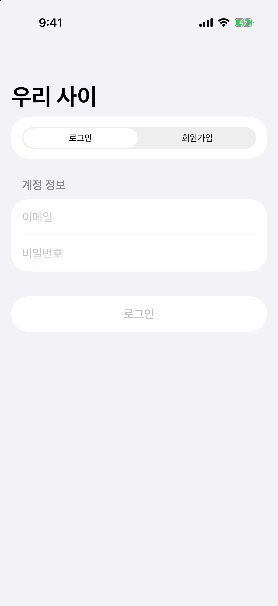
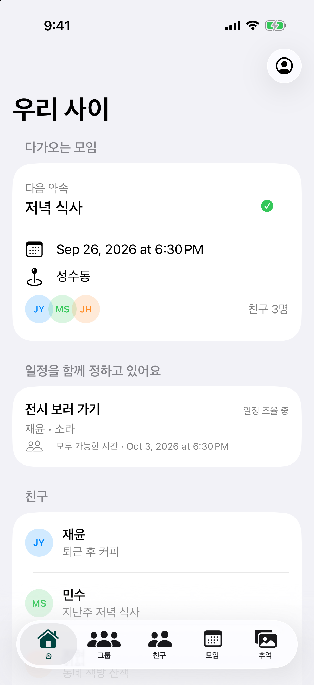
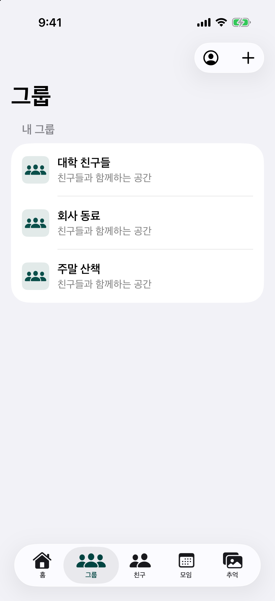
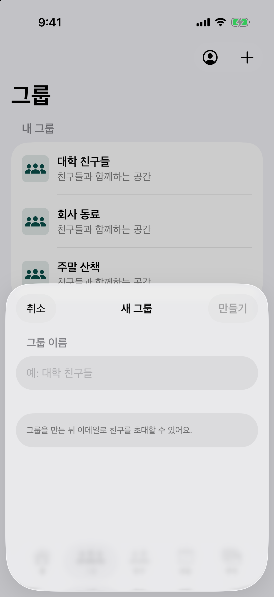
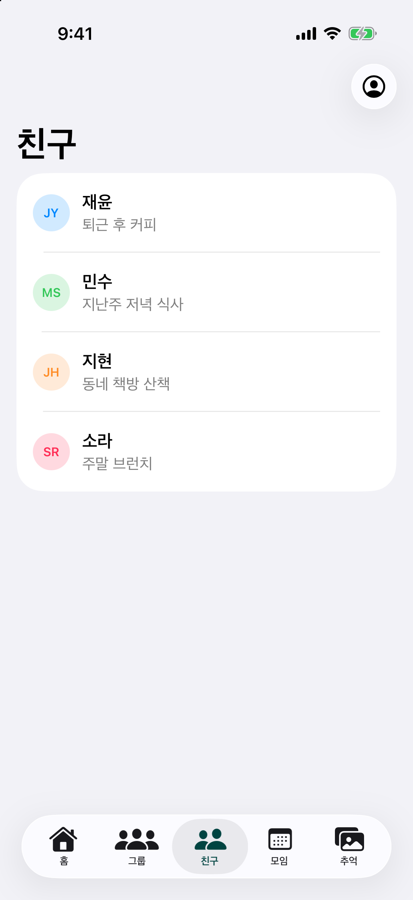
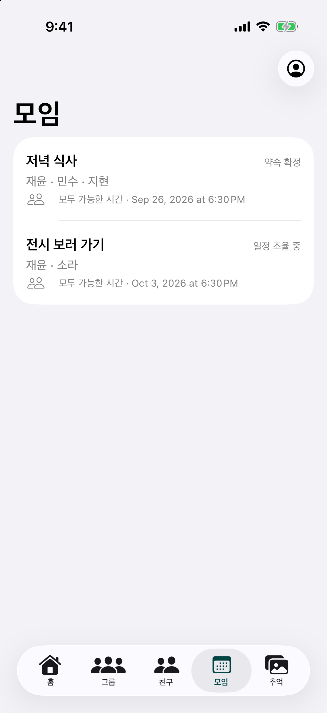
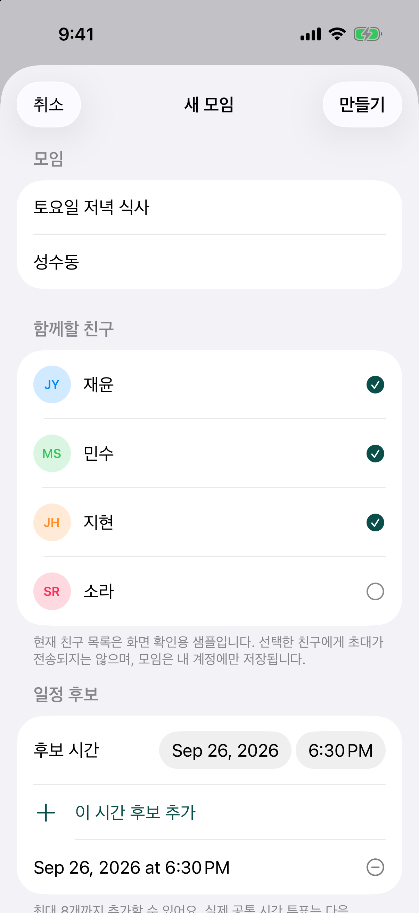
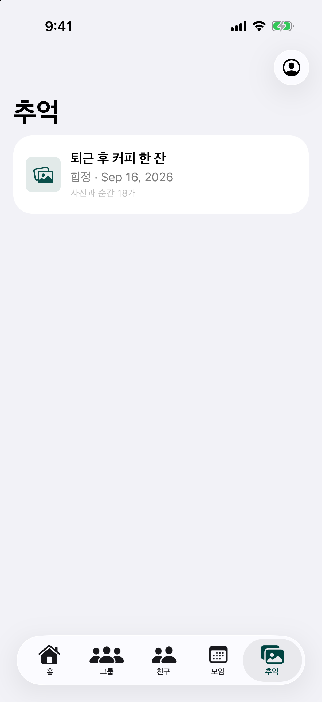

# 우리 사이

친구들과 약속을 정하고, 함께한 시간을 추억으로 남기는 프라이빗 관계 중심 iOS 앱입니다.

  

## 기획 이유

현재 대부분의 SNS가 친구와 소식을 나누는 기능을 넘어 추천 콘텐츠와 광고, 유명 인플루언서의 콘텐츠를 소비하는 공간으로 확장되고 있다는 문제의식에서 출발했습니다. 우리 사이는 공개적인 반응을 모으는 대신 실제로 아는 사람과 약속을 정하고 만나며, 함께한 순간을 다시 찾을 수 있게 돕습니다. 팔로워·좋아요 경쟁과 추천 피드는 제품 목표에서 제외합니다.

[기획 배경, 설계 원칙, MVP 범위 읽기](docs/product-rationale.md)

## 앱 화면

아래 화면은 Debug 미리보기에서 샘플 데이터로 캡처했습니다. 그룹 화면도 예시 그룹을 사용하며 Firebase 계정이나 서버 데이터를 변경하지 않습니다.

재캡처할 때는 Debug 스킴의 Launch Arguments에 `--screenshot-preview`와 `--screenshot-tab=home|groups|friends|meetups|memories`를 지정합니다. 그룹 생성 시트는 `--screenshot-group-create`, 모임 생성 시트는 `--screenshot-tab=meetups`와 `--screenshot-meetup-create`도 추가합니다.

<table>
  <tr>
    <td align="center"><strong>로그인</strong> </td>
    <td align="center"><strong>홈</strong> </td>
    <td align="center"><strong>그룹</strong> </td>
  </tr>
  <tr>
    <td align="center"><strong>그룹 만들기</strong> </td>
    <td align="center"><strong>친구</strong> </td>
    <td align="center"><strong>모임</strong> </td>
  </tr>
  <tr>
    <td align="center"><strong>모임 만들기</strong> </td>
    <td align="center"><strong>추억</strong> </td>
  </tr>
</table>

## 주요 흐름

- 친구와 여러 그룹을 만들고 이메일로 초대
- 그룹 멤버 중 참가자를 골라 모임과 일정 후보를 생성
- 참가자별 가능 시간을 저장하고 모임 화면에서 실시간으로 응답 확인
- 모임 만든 사람이 후보 시간을 최종 확정
- 추천 피드, 팔로워 수, 좋아요 수를 중심에 두지 않는 관계 경험

## 기술 구성

- SwiftUI, iOS 17 이상
- Firebase Authentication
- Cloud Firestore

## 현재 구현 범위

Firebase 이메일 인증과 Firestore 그룹 생성·이메일 초대, 참가자 선택형 공동 모임, 참가자별 일정 응답·실시간 동기화·작성자 일정 확정, 모임 당일 수동 도착 상태 공유가 구현되어 있습니다. 2026-09-28 운영 프로젝트 `uri-sai-a8c73`에 로컬 검증 Rules를 배포했고 `npm run verify:rules:production`으로 게시 내용과 로컬 `firestore.rules`의 일치를 확인했습니다. Firestore Emulator 규칙 테스트 7개와 iOS Simulator Debug 빌드도 통과했습니다. 읽기 전용 운영 확인에서 공유 그룹·모임이 발견되지 않아 migration은 실행하지 않았습니다. Auth 계정은 하나뿐이므로 실제 A/B 검증은 두 번째 이메일 인증 완료 계정이 준비될 때까지 미완료입니다. GPS 추적은 하지 않습니다. 친구 목록과 추억은 실제 데이터에 연결되지 않았으며 공동 사진 업로드, 자동 추억, 알림, 계정 삭제와 출시 운영 기능은 후속 MVP 작업입니다.

## 실행

1. `PrivateCircle.xcodeproj`를 Xcode에서 엽니다.
2. `PrivateCircle` 스킴과 iOS 시뮬레이터 또는 연결된 기기를 선택합니다.
3. 빌드 후 실행합니다.

Firebase 기능을 사용하려면 프로젝트에 맞는 `GoogleService-Info.plist`와 Firebase Console 설정이 필요합니다. 기본 Firebase 프로젝트는 `.firebaserc`에 고정되어 있습니다. 운영 Rules를 게시하기 전 `npm run test:rules`와 대상 프로젝트를 다시 확인하고, `npm run login:firebase`로 직접 인증한 후 `npm run deploy:rules:production`을 실행합니다. 이어서 `npm run verify:rules:production`으로 게시된 기본 데이터베이스 Rules와 로컬 파일의 일치를 확인합니다. 이 명령들은 저장소 밖의 쓰기 가능한 CLI 설정 경로를 사용하며, 배포 명령은 `uri-sai-a8c73`의 Firestore Rules만 대상으로 합니다. 이 저장소의 Rules는 자동 배포되지 않습니다. 현재 운영 데이터에서 그룹·공동 모임이 발견되지 않아 migration은 불필요하며, 과거 레코드가 확인될 경우 참가자 검증 및 기존 참조 보존을 포함하는 idempotent backfill 절차를 먼저 dry-run으로 수행해야 합니다.
\n---\n\n## English

PrivateCircle (우리 사이) is a private, relationship-centered iOS app for making plans with friends and preserving memories of time together. It focuses on people you know rather than recommendation feeds or competition for followers and likes. See the [product rationale](docs/product-rationale.md).

### Screenshots and flows

The screenshots above use sample data in Debug previews; the group examples do not modify Firebase accounts or server data. To recapture them, use the Debug scheme with `--screenshot-preview` and `--screenshot-tab=home|groups|friends|meetups|memories`. Add `--screenshot-group-create` for the group creation sheet, or `--screenshot-tab=meetups` and `--screenshot-meetup-create` for the meetup creation sheet.

Users can create groups and invite friends by email, select participants and propose meetup times, save availability and see responses in real time, and have the meetup creator finalize a time. The product does not center recommendations, follower counts, or likes.

### Technology and current scope

The app uses SwiftUI, iOS 17+, Firebase Authentication, and Cloud Firestore. Implemented features include email authentication, group creation and email invitations, shared meetups with selected participants, individual availability responses and real-time synchronization, creator confirmation, and manual arrival-status sharing on the day. There is no GPS tracking.

On 2026-09-28, locally verified Firestore Rules were deployed to `uri-sai-a8c73` and `npm run verify:rules:production` confirmed the published rules matched `firestore.rules`. Seven Firestore Emulator rule tests and an iOS Simulator Debug build passed. Read-only production inspection found no shared groups or meetups, so no migration was run. Actual two-user A/B verification remains incomplete until a second email-verified account is available. Friends and memories are not connected to real data; shared photo uploads, automatic memories, notifications, account deletion, and release operations remain future MVP work.

### Run and Firebase

Open `PrivateCircle.xcodeproj` in Xcode, select the `PrivateCircle` scheme and a simulator or connected device, then build and run. Firebase requires a suitable `GoogleService-Info.plist` and Firebase Console configuration. The default Firebase project is fixed in `.firebaserc`.

Before publishing rules, run `npm run test:rules`, recheck the target project, authenticate with `npm run login:firebase`, and run `npm run deploy:rules:production`; then run `npm run verify:rules:production` to compare the published default database rules with the local file. These commands use writable CLI configuration outside the repository; deployment targets only the Firestore Rules of `uri-sai-a8c73`, and rules are not deployed automatically. If older records are found, first dry-run an idempotent backfill that validates participants and preserves existing references.
