# 우리 사이

[日本語](https://github.com/hjy0221/PrivateCircle#%E6%97%A5%E6%9C%AC%E8%AA%9E) · [English](https://github.com/hjy0221/PrivateCircle#english) · [한국어](https://github.com/hjy0221/PrivateCircle#%ED%95%9C%EA%B5%AD%EC%96%B4)

## 日本語

友達との約束を決めて、一緒にした時間を思い出に残すプライベート関係中心のiOSアプリです。

  

## 企画理由

現在、ほとんどのSNSが友達とニュースを分ける機能を超えて、おすすめコンテンツや広告、有名インフルエンサーのコンテンツを消費する空間に拡張されているという問題意識から出発しました。私たちの間は、公的な反応を集めるのではなく、実際に知っている人と約束を決め、会い、一緒にした瞬間を再発見するのを助けます。フォロワー・いいね 競争とおすすめフィードは商品目標から除外します。

[企画背景、設計原則、MVP範囲を読む](docs/product-rationale.md)

## アプリ画面

以下の画面は、デバッグプレビューでサンプルデータとしてキャプチャしました。グループ画面も例のグループを使用し、Firebaseアカウントやサーバーデータを変更しません。

再キャプチャするときは、Debug スキームの Launch Arguments に `--screenshot-preview` と `--screenshot-tab=home|groups|friends|meetups|memories` を指定します。グループ作成シートは`--screenshot-group-create`、会議作成シートは`--screenshot-tab=meetups`と`--screenshot-meetup-create`も追加します。

<table>
  <tr>
    <td align="center"><strong>ログイン</strong> 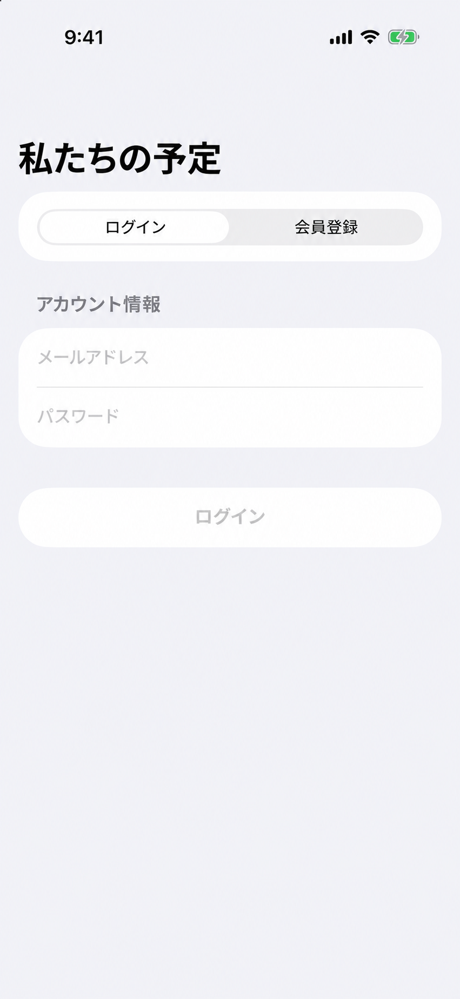</td>
    <td align="center"><strong>ホーム</strong> 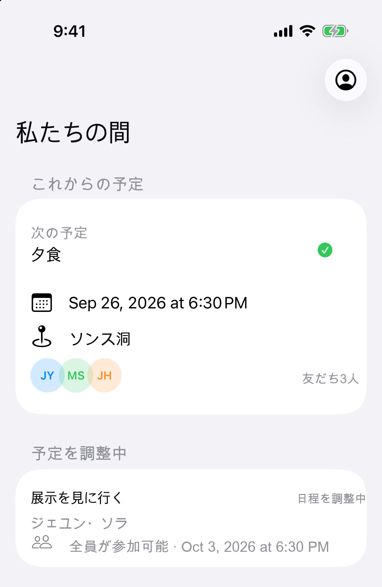</td>
    <td align="center"><strong>グループ</strong> 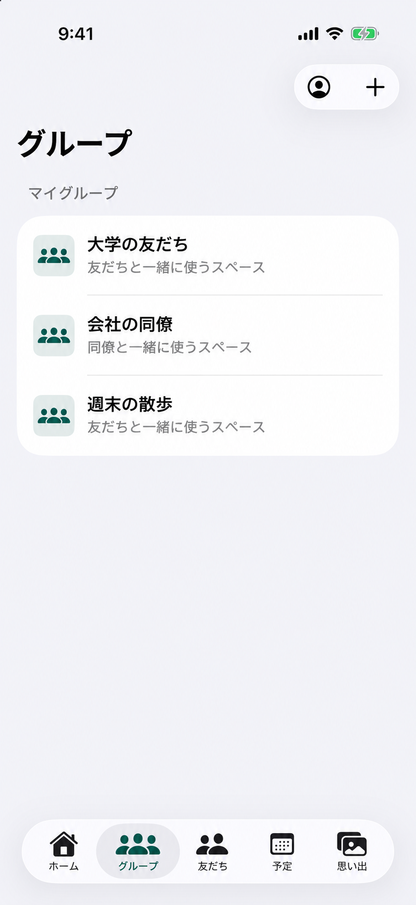</td>
  </tr>
  <tr>
    <td align="center"><strong>グループの作成</strong> 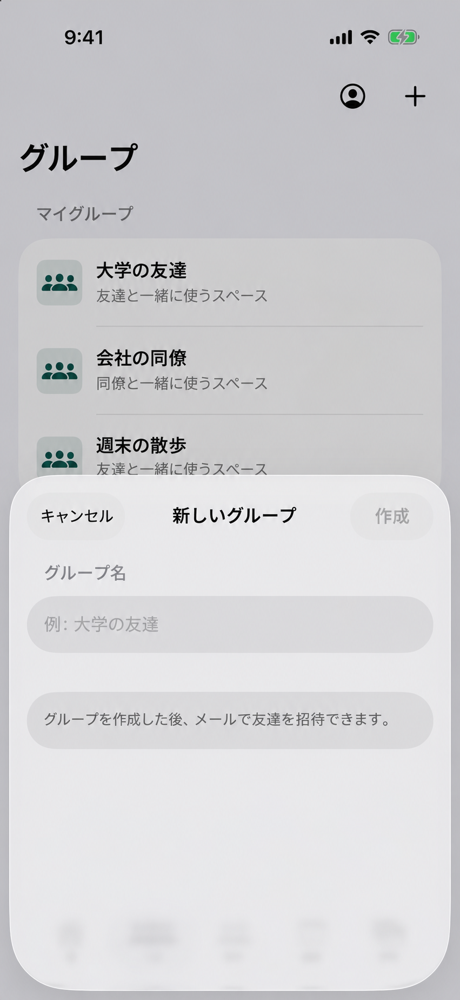</td>
    <td align="center"><strong>友達</strong> 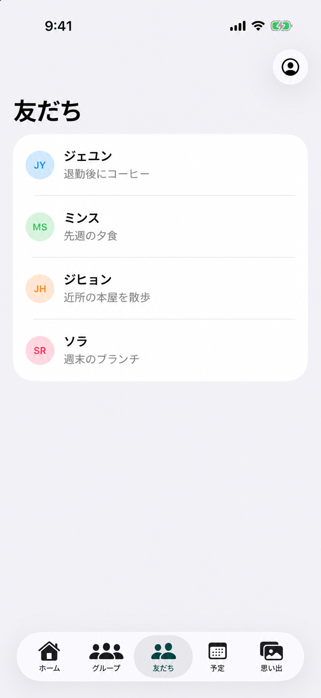</td>
    <td align="center"><strong>会議</strong> 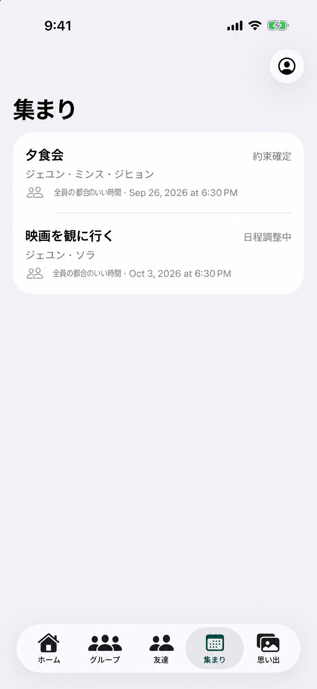</td>
  </tr>
  <tr>
    <td align="center"><strong>会議の作成</strong> 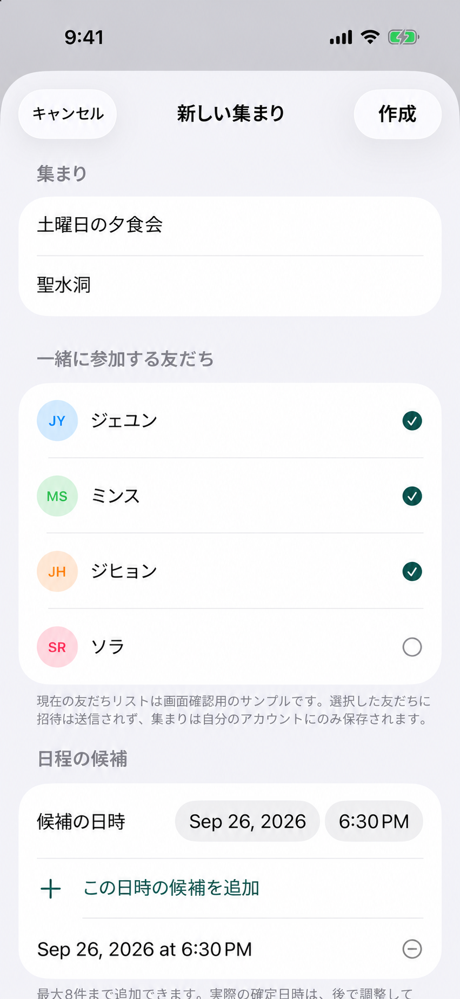</td>
    <td align="center"><strong>思い出</strong> 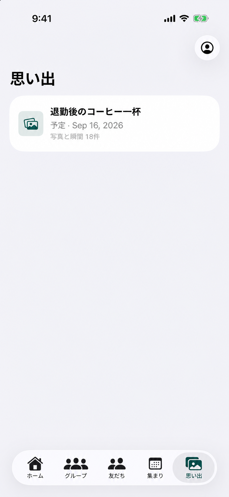</td>
  </tr>
</table>

## メインフロー

- 友達や複数のグループを作成し、電子メールで招待
- グループメンバーのうち参加者を選んで集まりとスケジュール候補を生成
- 参加者別の可能時間を保存し、会議画面でリアルタイムで応答を確認
- 会議の作成者が候補時間を最終確定
- おすすめフィード、フォロワー数、いいね数を中心に置かない関係経験

## 技術構成

- SwiftUI、iOS 17以降
- Firebase Authentication
- Cloud Firestore

## 現在の実装範囲

Firebase メール認証と Firestore グループ作成・メール招待、参加者選択型共同会議、参加者別スケジュール応答・リアルタイム同期・作成者スケジュール確定、会議当日手動到着状態共有が実装されています。 2026-09-28 運用プロジェクト`uri-sai-a8c73`にローカル検証ルールを配布し、`npm run verify:rules:production`で公開内容とローカル`firestore.rules`の一致を確認しました。 Firestore Emulator Rule Test 7とiOS Simulator Debugのビルドも通過しました。読み取り専用運用確認で共有グループ・会議が見つからなかったため、migrationは実行していません。 Authアカウントは1つだけなので、実際のA / B検証は2番目のEメール認証完了アカウントが準備されるまで未完了です。 GPS追跡は行いません。友達リストと思い出は実際のデータにリンクされておらず、共同写真のアップロード、自動思い出、通知、アカウントの削除、リリース操作などの機能は後続のMVPタスクです。

## 実行

1. `PrivateCircle.xcodeproj`をXcodeで開きます。
2. `PrivateCircle`スキームとiOSシミュレータまたは接続機器を選択します。
3. ビルド後に実行します。

Firebase機能を使用するには、プロジェクトに適した`GoogleService-Info.plist`とFirebase Consoleの設定が必要です。デフォルトのFirebaseプロジェクトは`.firebaserc`に固定されています。運用ルールを公開する前に`npm run test:rules`とターゲットプロジェクトを再確認し、`npm run login:firebase`で直接認証して`npm run deploy:rules:production`を実行します。次に、`npm run verify:rules:production`として公開されたデフォルトのデータベースルールとローカルファイルの一致を確認します。これらのコマンドはリポジトリ外の書き込み可能なCLI設定パスを使用し、展開コマンドは`uri-sai-a8c73`のFirestore Rulesのみを対象としています。このリポジトリのルールは自動配布されません。現在の運用データでグループ・共同会議が見つからないため、migrationは不要で、過去のレコードが確認された場合は、参加者の検証と既存の参照保存を含むidempotent backfill手順を最初にdry-runで行う必要があります。

## English

It is a private relationship-centered iOS app that allows you to make appointments with friends and make memories of the time spent together.

  

## Reason for planning

It started from the awareness that most SNSs are currently expanding beyond the function of sharing news with friends to a space for consuming recommended content, advertisements, and content from famous influencers. Instead of collecting public reactions, Among Us helps you make appointments and meet up with people you actually know and relive the moments you have together. Follower/like competition and recommendation feeds are excluded from product goals.

[Read the planning background, design principles, and MVP scope](docs/product-rationale.md)

## App screen

The screen below was captured with sample data from the Debug preview. The Groups screen also uses example groups and doesn't change any Firebase account or server data.

When recapturing, specify `--screenshot-preview` and `--screenshot-tab=home|groups|friends|meetups|memories` in the Launch Arguments of the Debug scheme. Also add `--screenshot-group-create` to the group creation sheet and `--screenshot-tab=meetups` and `--screenshot-meetup-create` to the meeting creation sheet.

<table>
  <tr>
    <td align="center"><strong>Login</strong> 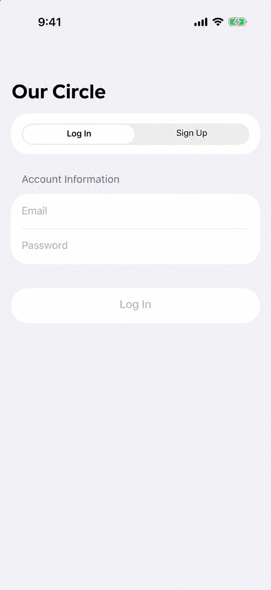</td>
    <td align="center"><strong>Home</strong> 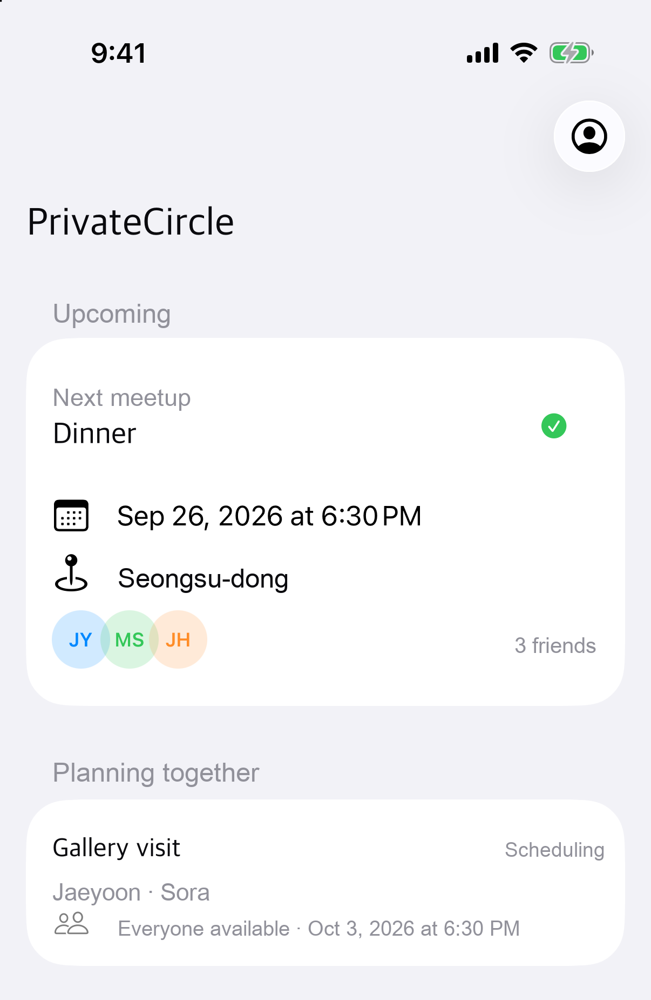</td>
    <td align="center"><strong>Group</strong> 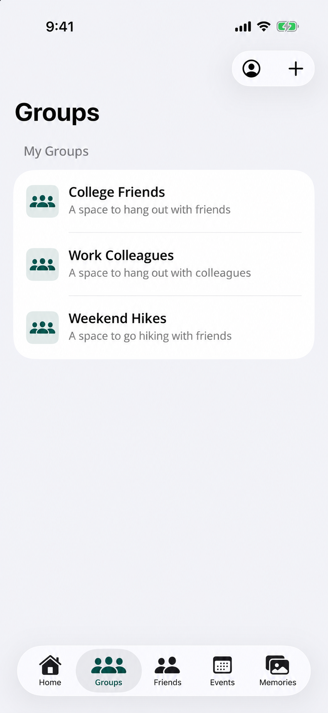</td>
  </tr>
  <tr>
    <td align="center"><strong>Create group</strong> 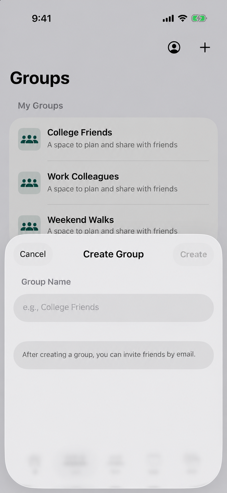</td>
    <td align="center"><strong>Friends</strong> 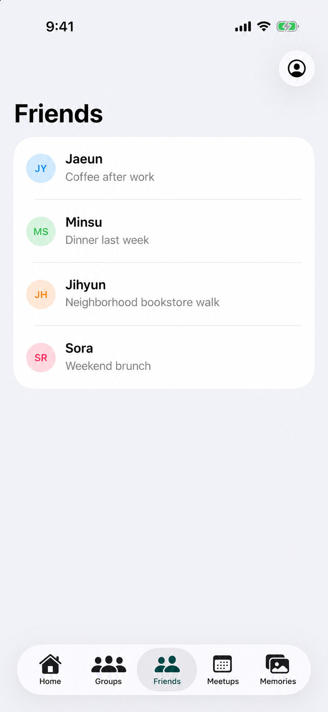</td>
    <td align="center"><strong>Meetings</strong> 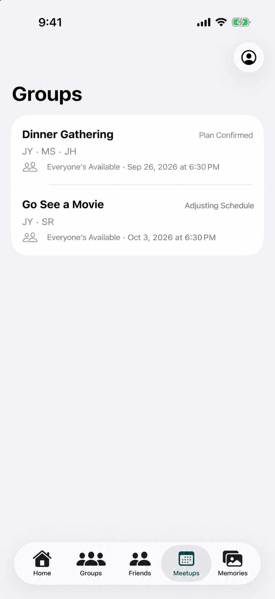</td>
  </tr>
  <tr>
    <td align="center"><strong>Create a meeting</strong> 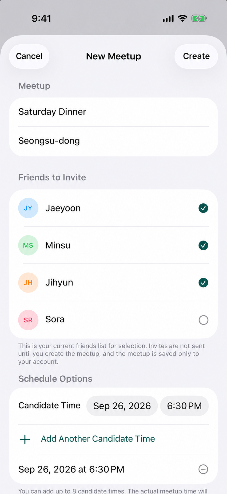</td>
    <td align="center"><strong>Memories</strong> 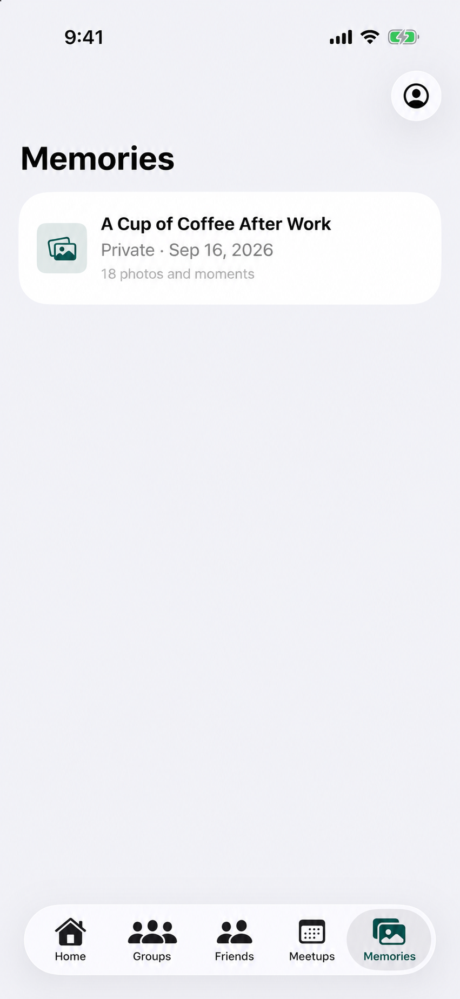</td>
  </tr>
</table>

## Main flow

- Create multiple groups with friends and invite them by email
- Select participants from group members to create meeting and schedule candidates
- Save the available time for each participant and check responses in real time on the meeting screen
- The person who created the meeting finalizes the candidate time.
- A relationship experience that doesn't center around recommendation feeds, follower counts, or likes

## Technical configuration

- SwiftUI, iOS 17 or higher
-Firebase Authentication
- Cloud Firestore

## Current implementation scope

Firebase email authentication, Firestore group creation, email invitation, participant-selected joint meeting, schedule response for each participant, real-time synchronization, author's schedule confirmation, and manual arrival status sharing on the day of the meeting are implemented. 2026-09-28 Local verification rules were deployed to the operational project `uri-sai-a8c73`, and `npm run verify:rules:production` confirmed that the published content matches local `firestore.rules`. It also passed the 7 Firestore Emulator rule tests and the iOS Simulator Debug build. No shared groups/meetings were found in the read-only operation check, so migration was not executed. Because there is only one Auth account, the actual A/B validation is not complete until the second email-verified account is ready. There is no GPS tracking. Friends list and Memories are not linked to real data, and joint photo uploads, automatic Memories, notifications, account deletion and launch operations features are follow-up MVP efforts.

## run

1. Open `PrivateCircle.xcodeproj` in Xcode.
2. Select the `PrivateCircle` scheme and the iOS simulator or connected device.
3. Build and run.

To use Firebase features, you need `GoogleService-Info.plist` and Firebase Console settings appropriate for your project. The default Firebase project is anchored at `.firebaserc`. Before posting operational rules, check again `npm run test:rules` and the target project, authenticate directly with `npm run login:firebase`, and then run `npm run deploy:rules:production`. Next, we check that the local file matches the default database Rules published as `npm run verify:rules:production`. These commands use a writable CLI setup path outside of the repository, and the deployment commands only target Firestore Rules in `uri-sai-a8c73`. Rules in this repository are not automatically deployed. Migration is unnecessary as no group/communal gatherings are found in the current operational data, and if past records are identified, an idempotent backfill procedure, including verification of participants and preservation of existing references, must first be performed as a dry-run.

## 한국어

친구들과 약속을 정하고, 함께한 시간을 추억으로 남기는 프라이빗 관계 중심 iOS 앱입니다.

  

## 기획 이유

현재 대부분의 SNS가 친구와 소식을 나누는 기능을 넘어 추천 콘텐츠와 광고, 유명 인플루언서의 콘텐츠를 소비하는 공간으로 확장되고 있다는 문제의식에서 출발했습니다. 우리 사이는 공개적인 반응을 모으는 대신 실제로 아는 사람과 약속을 정하고 만나며, 함께한 순간을 다시 찾을 수 있게 돕습니다. 팔로워·좋아요 경쟁과 추천 피드는 제품 목표에서 제외합니다.

[기획 배경, 설계 원칙, MVP 범위 읽기](docs/product-rationale.md)

## 앱 화면

아래 화면은 Debug 미리보기에서 샘플 데이터로 캡처했습니다. 그룹 화면도 예시 그룹을 사용하며 Firebase 계정이나 서버 데이터를 변경하지 않습니다.

재캡처할 때는 Debug 스킴의 Launch Arguments에 `--screenshot-preview`와 `--screenshot-tab=home|groups|friends|meetups|memories`를 지정합니다. 그룹 생성 시트는 `--screenshot-group-create`, 모임 생성 시트는 `--screenshot-tab=meetups`와 `--screenshot-meetup-create`도 추가합니다.

<table>
  <tr>
    <td align="center"><strong>로그인</strong> 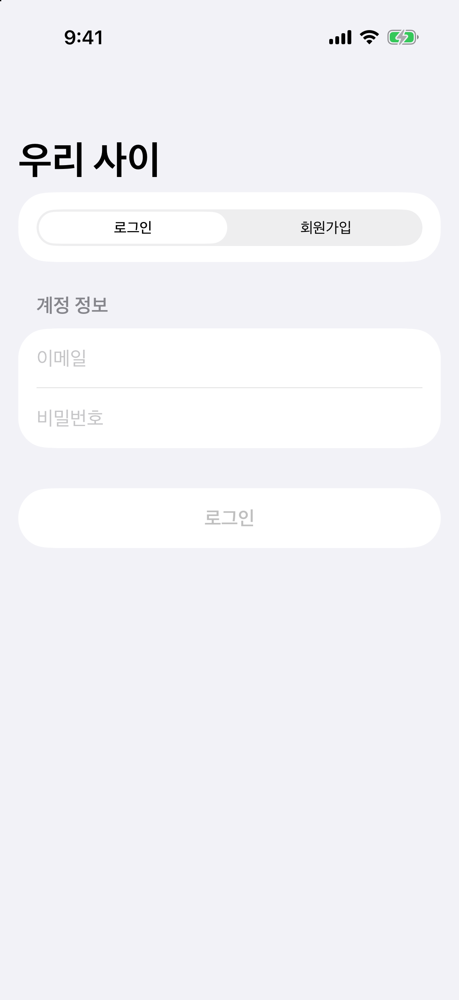</td>
    <td align="center"><strong>홈</strong> 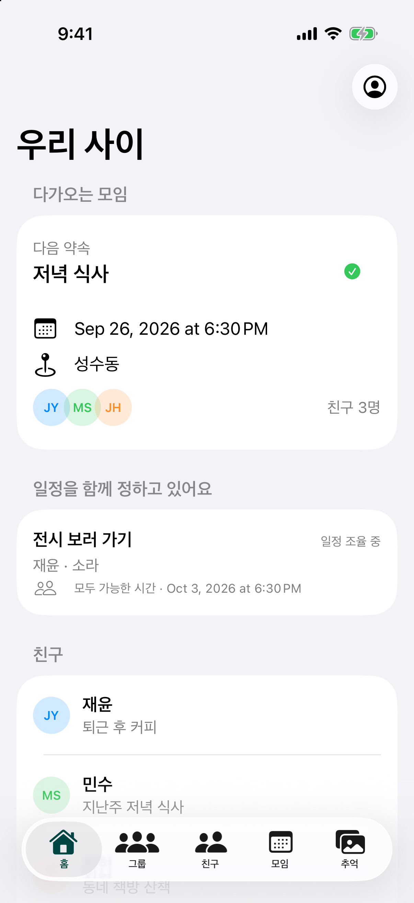</td>
    <td align="center"><strong>그룹</strong> 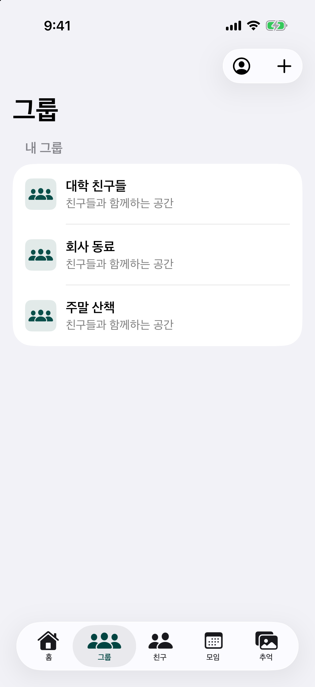</td>
  </tr>
  <tr>
    <td align="center"><strong>그룹 만들기</strong> 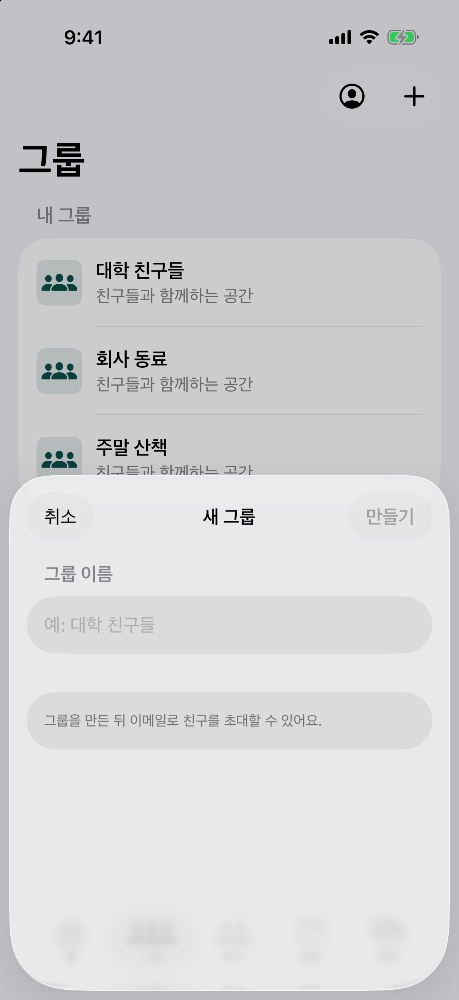</td>
    <td align="center"><strong>친구</strong> 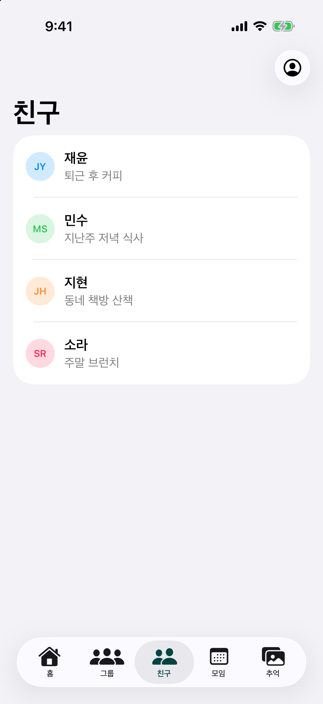</td>
    <td align="center"><strong>모임</strong> 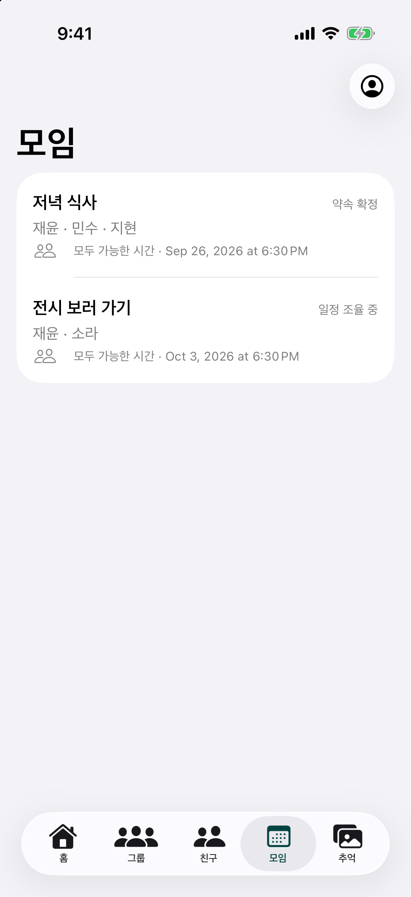</td>
  </tr>
  <tr>
    <td align="center"><strong>모임 만들기</strong> 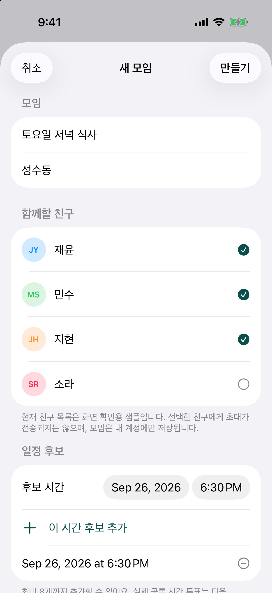</td>
    <td align="center"><strong>추억</strong> 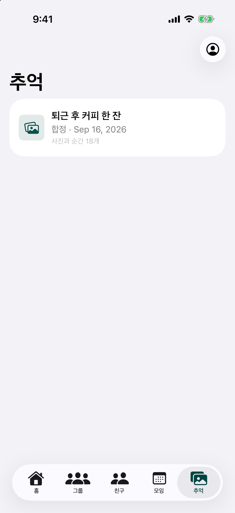</td>
  </tr>
</table>

## 주요 흐름

- 친구와 여러 그룹을 만들고 이메일로 초대
- 그룹 멤버 중 참가자를 골라 모임과 일정 후보를 생성
- 참가자별 가능 시간을 저장하고 모임 화면에서 실시간으로 응답 확인
- 모임 만든 사람이 후보 시간을 최종 확정
- 추천 피드, 팔로워 수, 좋아요 수를 중심에 두지 않는 관계 경험

## 기술 구성

- SwiftUI, iOS 17 이상
- Firebase Authentication
- Cloud Firestore

## 현재 구현 범위

Firebase 이메일 인증과 Firestore 그룹 생성·이메일 초대, 참가자 선택형 공동 모임, 참가자별 일정 응답·실시간 동기화·작성자 일정 확정, 모임 당일 수동 도착 상태 공유가 구현되어 있습니다. 2026-09-28 운영 프로젝트 `uri-sai-a8c73`에 로컬 검증 Rules를 배포했고 `npm run verify:rules:production`으로 게시 내용과 로컬 `firestore.rules`의 일치를 확인했습니다. Firestore Emulator 규칙 테스트 7개와 iOS Simulator Debug 빌드도 통과했습니다. 읽기 전용 운영 확인에서 공유 그룹·모임이 발견되지 않아 migration은 실행하지 않았습니다. Auth 계정은 하나뿐이므로 실제 A/B 검증은 두 번째 이메일 인증 완료 계정이 준비될 때까지 미완료입니다. GPS 추적은 하지 않습니다. 친구 목록과 추억은 실제 데이터에 연결되지 않았으며 공동 사진 업로드, 자동 추억, 알림, 계정 삭제와 출시 운영 기능은 후속 MVP 작업입니다.

## 실행

1. `PrivateCircle.xcodeproj`를 Xcode에서 엽니다.
2. `PrivateCircle` 스킴과 iOS 시뮬레이터 또는 연결된 기기를 선택합니다.
3. 빌드 후 실행합니다.

Firebase 기능을 사용하려면 프로젝트에 맞는 `GoogleService-Info.plist`와 Firebase Console 설정이 필요합니다. 기본 Firebase 프로젝트는 `.firebaserc`에 고정되어 있습니다. 운영 Rules를 게시하기 전 `npm run test:rules`와 대상 프로젝트를 다시 확인하고, `npm run login:firebase`로 직접 인증한 후 `npm run deploy:rules:production`을 실행합니다. 이어서 `npm run verify:rules:production`으로 게시된 기본 데이터베이스 Rules와 로컬 파일의 일치를 확인합니다. 이 명령들은 저장소 밖의 쓰기 가능한 CLI 설정 경로를 사용하며, 배포 명령은 `uri-sai-a8c73`의 Firestore Rules만 대상으로 합니다. 이 저장소의 Rules는 자동 배포되지 않습니다. 현재 운영 데이터에서 그룹·공동 모임이 발견되지 않아 migration은 불필요하며, 과거 레코드가 확인될 경우 참가자 검증 및 기존 참조 보존을 포함하는 idempotent backfill 절차를 먼저 dry-run으로 수행해야 합니다.
